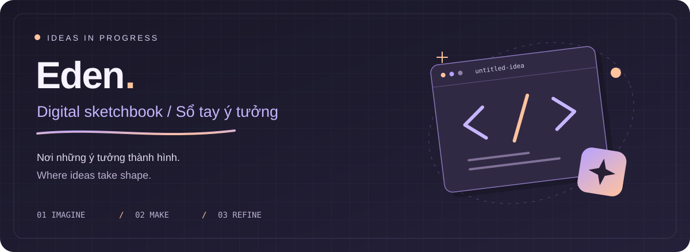

  

   
   

<strong>Những gì mình làm, đang thử, và chưa nghĩ xong.</strong> 
<em>Things I've made, things I'm trying, and ideas I'm still figuring out.</em>

 

## Chào bạn, mình là Eden 👋 Hey, I'm Eden

Đây là cuốn sổ tay số của mình. Phần lớn những thứ trong này bắt đầu bằng một câu hỏi khá đơn giản: _“Nếu thử làm thế này thì sao?”_ Rồi mình mở editor, làm một bản nhỏ và xem ý tưởng ấy có đi được xa hơn không.

_This is my digital sketchbook. Most things here start with a simple “what if?” Then I open the editor, make something small, and see where the idea takes me._

Điều mình thích ở việc viết code là được vừa nghĩ vừa làm. Có lúc thử một cách mới, có lúc chỉ ngồi chỉnh một chi tiết cho vừa ý. Mình giữ lại cả những bản nháp — biết đâu lần sau mở lại, chúng dẫn đến một thứ khác.

_What I enjoy about coding is thinking things through by making them. Sometimes that means trying a new approach; sometimes it's tweaking one small detail until it feels right. I keep the rough drafts too — an old idea might turn into something new._

 

## Từ nháp đến chạy được From a sketch to something that works

<table>
  <tr>
    <td width="33%" valign="top">
      <h3>01 / Phác Imagine</h3>
      
Một câu hỏi, một nét vẽ, một ghi chú ngắn. Mình ghi lại trước, rồi mới nghĩ xem có thể làm gì với nó.

      
<em>A question, a doodle, a quick note. I jot it down first, then figure out what I could make of it.</em>

    </td>
    <td width="33%" valign="top">
      <h3>02 / Làm thử Make</h3>
      
Mình bắt đầu với một bản nhỏ, đủ để thử ý chính. Đến lúc tự tay làm mới biết chỗ nào ổn, chỗ nào cần nghĩ lại.

      
<em>I start with something small enough to test the idea. Making it helps me see what works and what needs another look.</em>

    </td>
    <td width="33%" valign="top">
      <h3>03 / Chỉnh tiếp Refine</h3>
      
Đổi một câu chữ, chỉnh một khoảng cách, bớt một bước thừa. Mình thích đoạn này: vẫn là ý tưởng ấy, nhưng dùng thấy dễ chịu hơn.

      
<em>Reword a line, adjust some spacing, remove an extra step. I like this part: it's still the same thing, just nicer to use.</em>

    </td>
  </tr>
</table>

 

## Lật thêm vài trang A few more pages

- **[Dự án & thử nghiệm · Projects & experiments](https://github.com/nlong5096?tab=repositories)** Có thứ đã thành hình, có thứ còn đang loay hoay. Mỗi repo giữ lại một phần của quá trình ấy. <em>Some things have taken shape; others are still a work in progress. Each repo holds a bit of that process.</em>
- **[Góc cảm hứng · Inspiration shelf](https://github.com/nlong5096?tab=stars)** Những repo mình muốn quay lại xem — vì một cách làm hay, một chi tiết thú vị, hoặc đơn giản là thấy thích. <em>Repos I want to come back to — for a clever approach, an interesting detail, or just because I like them.</em>

 

  

   
  <strong>Cuốn sổ vẫn đang viết tiếp. Cảm ơn bạn đã ghé qua.</strong> 
  <em>Still adding pages. Thanks for stopping by.</em>
   
   
  Eden ✦

